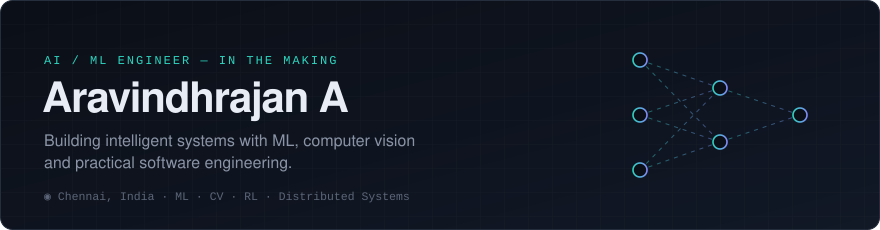
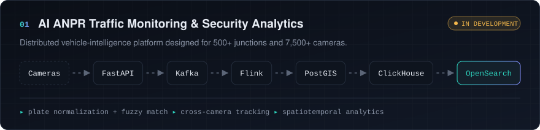
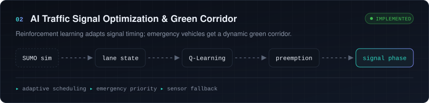
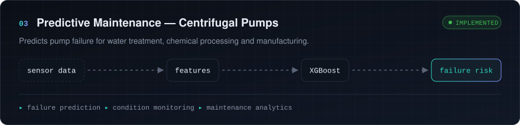
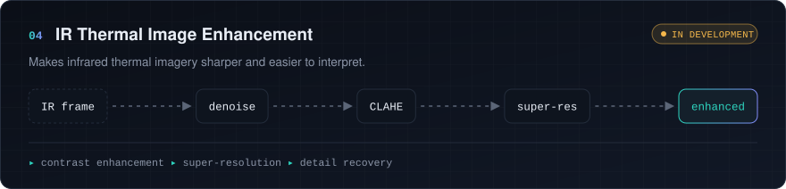
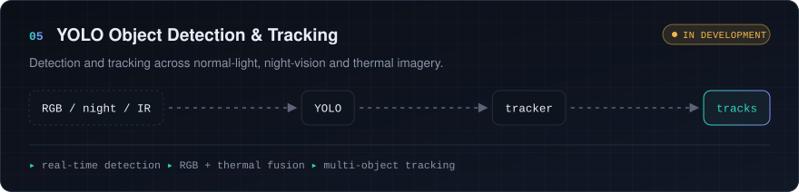
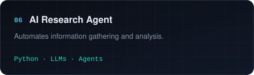
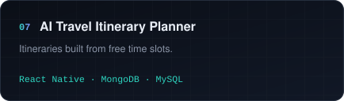
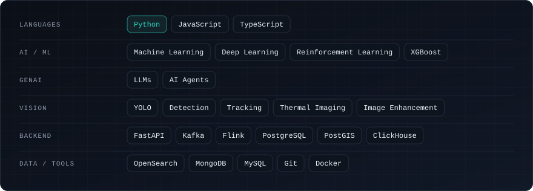

  
  

I build ML systems end to end — from the model to the pipeline that feeds it. Right now that means **traffic intelligence at city scale**, **RL-driven signal control**, and **vision for thermal and low-light imagery**.

### `▍` Featured work

<a href="#"><!-- TODO: add ANPR repo link --></a>

<a href="#"><!-- TODO: add IR thermal repo link --></a>

### `▍` Also built

  <a href="#"><!-- TODO: add research agent repo link --></a>
  

### `▍` Recognition

### `▍` Toolkit

### `▍` Activity

<picture>
  <source media="(prefers-color-scheme: dark)" srcset="https://raw.githubusercontent.com/aravindh13/aravindh13/output/snake-dark.svg">
  
</picture>
